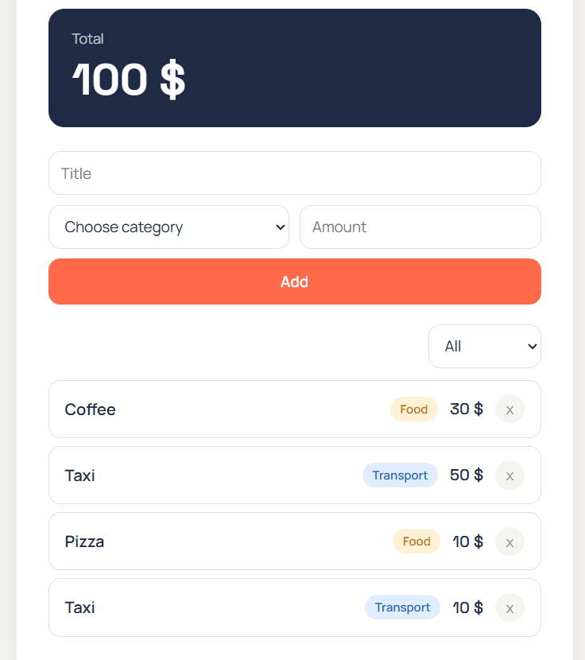

# Expense Tracker

A simple expense tracker built with vanilla JavaScript, without frameworks.

**Live demo:** https://kateryna25-art.github.io/expense-tracker/

## Features

- Add expenses with title, category and amount
- Delete any expense
- Filter expenses by category
- Total updates for the selected category
- Data is saved in localStorage, so it stays after page reload
- Responsive layout for mobile and desktop

## Tech stack

- HTML5
- CSS3 (custom properties, grid, flexbox, clamp)
- JavaScript (ES6+): objects and methods, array methods (`filter`,`reduce`,`forEach`), DOM, events, localStorage, JSON

## What I practiced

- Keeping data and UI separate: ave demo:** object stores data,A simple expenseandxpense Trackerdraw it
- Rendering a list from an array withuilt with vanillaandxpense Tra- Saving and loading data withpense tracker buil/ Expense Track
## Run locally

Clone the repository and openilt with vanilin a browser.
